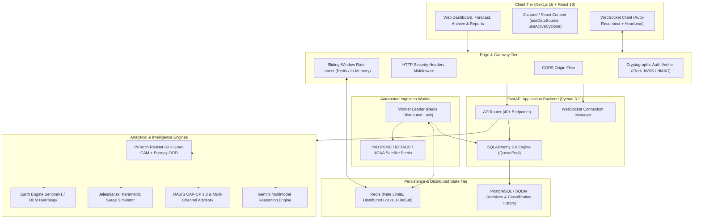
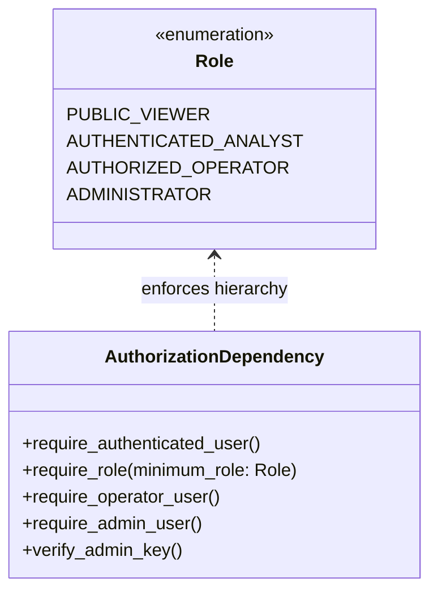
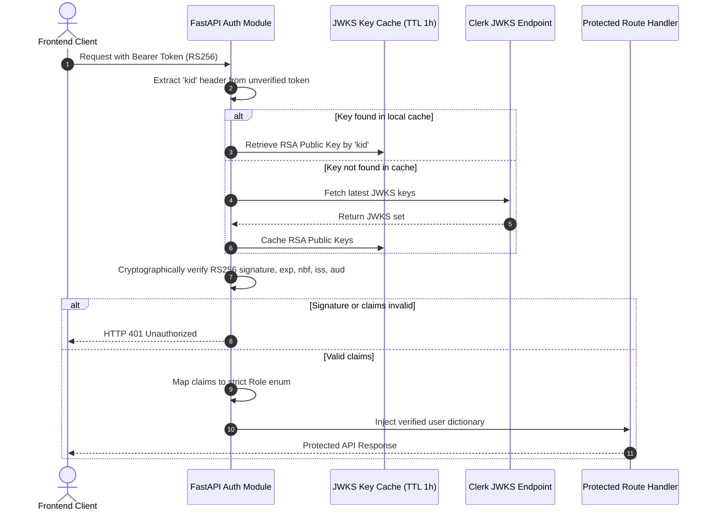
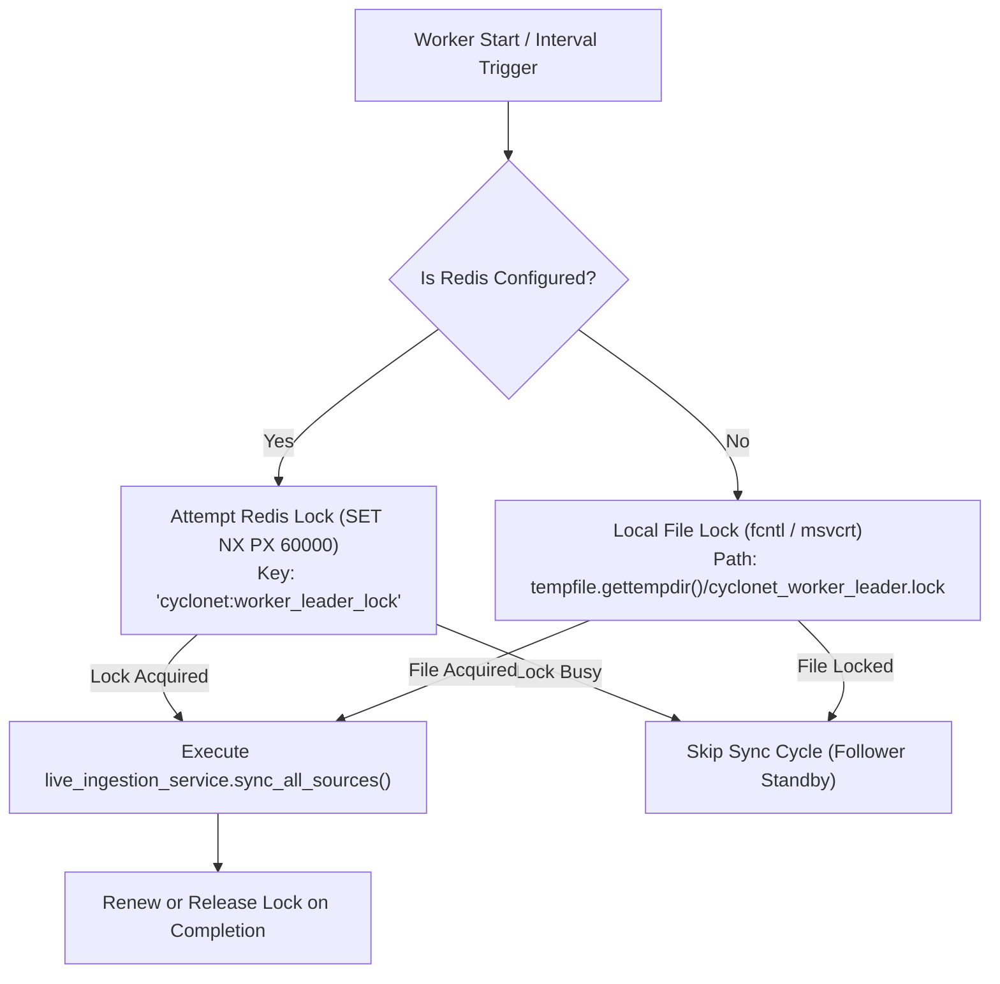
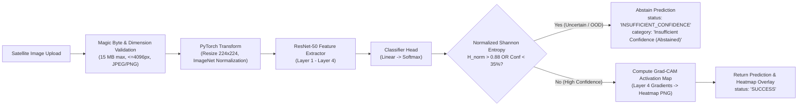
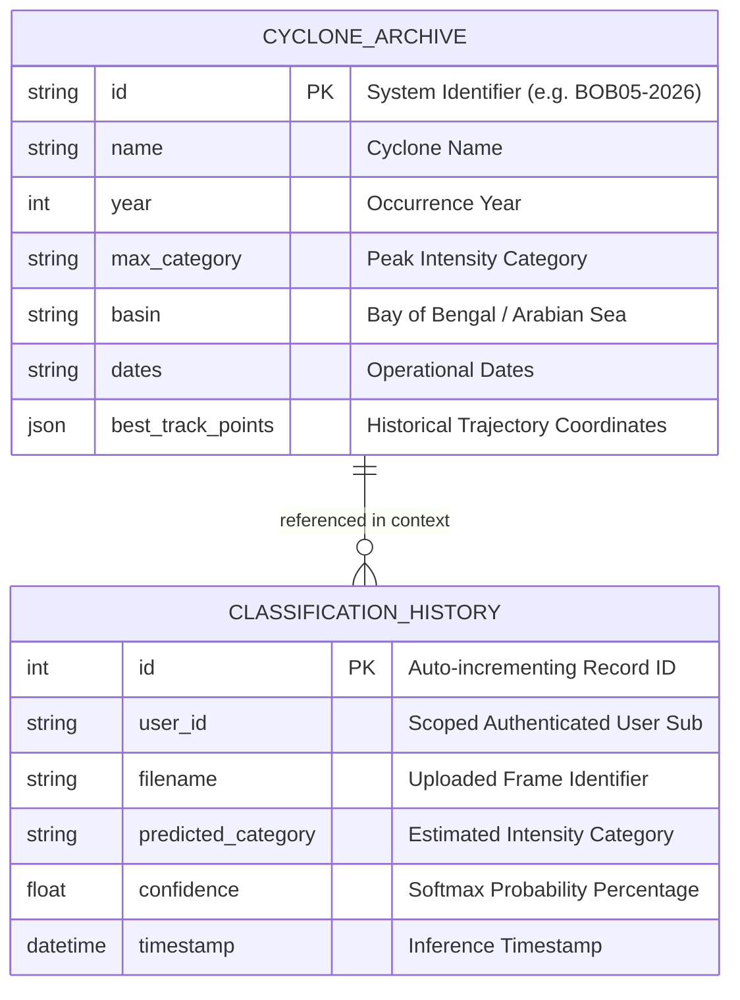

# CycloNet Production Architecture Specification

**Document Version:** 2.0.0 (Production Hardened)  
**System Target:** CycloNet Tropical Cyclone Monitoring, Forecast & Disaster-Intelligence Platform  
**Operational Status:** Experimental Decision Support System (Non-Operational Sandbox)

---

## 1. High-Level System Architecture

The CycloNet platform is architected as a decoupled, multi-tier system composed of a Next.js (App Router, Turbopack, React 19) frontend client, a FastAPI asynchronous Python backend, a PyTorch computer vision inference engine, a background meteorological ingestion worker, a Redis distributed cache/broker, and a relational database (PostgreSQL on Render, SQLite in local development).

---

## 2. Authentication & Authorization Architecture

### 2.1 Role-Based Access Control (RBAC) Hierarchy
Authentication enforces strict cryptographic identity verification with zero fallback to insecure test secrets in production. Roles are strictly enumerated and enforced using dependency injection.

### 2.2 JWT Verification & JWKS Key Rotation Flow
For Clerk authenticated sessions, asymmetric RS256 token verification is executed against Clerk's published JSON Web Key Set (JWKS), supporting automated key rotation without application downtime.

---

## 3. Distributed Concurrency & Process Locking

In multi-replica deployments (e.g. multiple container instances on Render or Kubernetes), only one leader instance must run the scheduled meteorological synchronization loop.

---

## 4. Machine Learning Inference Pipeline

The PyTorch computer vision pipeline processes uploaded satellite imagery to evaluate cyclonic convective signatures while strictly rejecting out-of-distribution noise through predictive entropy estimation.

---

## 5. Relational Data Architecture

---

## 6. Network Security & Header Policy

Every HTTP response from the FastAPI application passes through the security middleware, enforcing strict browser defense headers:

- `X-Content-Type-Options: nosniff` (prevents MIME type sniffing)
- `X-Frame-Options: DENY` (prevents clickjacking attacks)
- `Referrer-Policy: strict-origin-when-cross-origin` (prevents cross-origin URL leakage)
- `Permissions-Policy: geolocation=(), microphone=(), camera=()` (disables unused browser sensors)
- `Strict-Transport-Security: max-age=31536000; includeSubDomains` (enforced when accessed over HTTPS)
- `Access-Control-Allow-Origin`: Explicitly restricted to `https://cyclonet-frontend.onrender.com` (wildcards eliminated).
